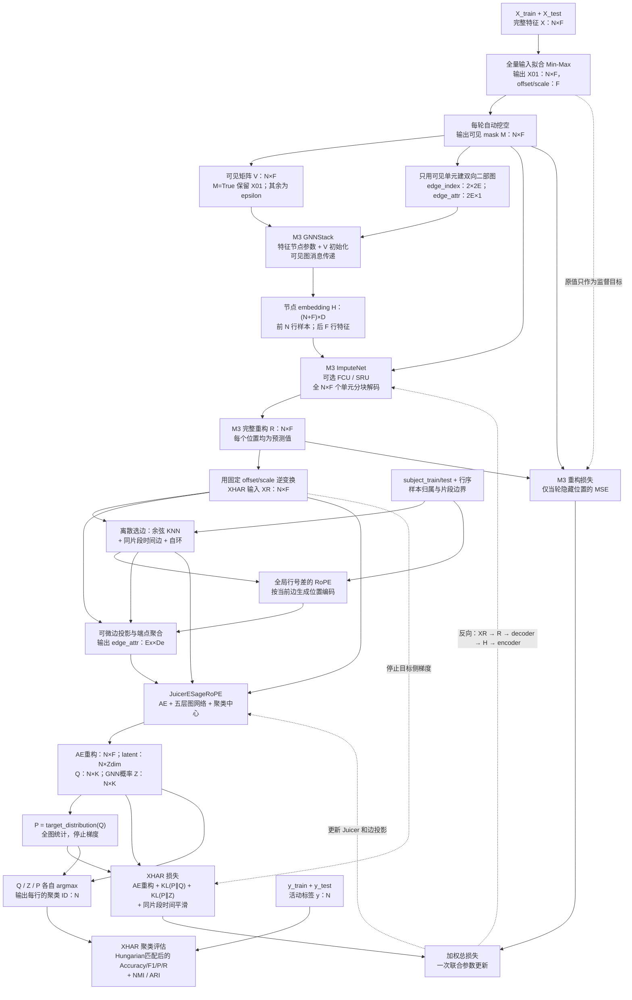

# 全量 UCI-HAR 联合架构数据流

`N=10,299` 个样本，`F=561` 个特征，`K=6` 个簇。
官方 train/test 只决定输入拼接顺序；全体样本参与本次传导式训练。

## 每种输入的去向

| 输入 | 使用模块 | 输出与用途 |
|---|---|---|
| 原始特征 X | Min-Max | X01、固定 offset/scale；允许使用全体输入的传导式预处理 |
| X01 与当轮随机数 | 挖空模块 | bool mask M；每轮新采样，无永久 7–3 划分 |
| X01、M | 可见矩阵与图构造 | V、仅可见单元的二部图和数值边属性 |
| V、可见图 | M3 encoder | `[样本节点; 特征节点]` embedding H |
| H、M、目标单元坐标 | ImputeNet / FCU / SRU | 完整预测 R；隐藏位置和可见位置都用预测输出 |
| R、offset/scale | 可微逆变换 | 与原始 UCI 数值尺度一致的 XR |
| XR、subject/片段信息 | XHAR 图构造 | 稀疏 edge_index；KNN 只读取 M3 重构，时间边不跨片段 |
| XR、edge_index、行号位置编码 | EdgeFeatures | 每条边的可微属性，梯度能回到 XR |
| XR、XHAR 图、边属性 | Juicer | AE 重构、AE latent、Q、GNN 概率 Z |
| Q | DEC target distribution | 停止梯度的 P，不读取 y |
| 原始 X01、M、R | M3 loss | 原值只在隐藏单元 MSE 中作为自监督目标 |
| Q、Z、P、AE 重构、XR | XHAR loss | 图聚类与重构目标；XR 的 target 副本停止梯度 |
| 活动标签 y、预测聚类 ID | metrics | 仅生成评估数值，不影响 loss、图、KMeans 或参数更新 |

## 评估时的变化

评估使用固定 `eval_seed` 生成的 mask，完整走同一条 M3 → XHAR 路径，关闭 dropout，
固定 SRU 的随机采样序列。使用最近一次保存的 XHAR 拓扑；边属性仍随当前重构计算。
所有 N 行参与评估。`M3 hidden RMSE` 额外使用隐藏原值作诊断，活动标签仍只流向 metrics。

## 实际反向实现

图中的反向箭头由 `joint/bridge.py` 显式实现：decoder 首次分块 forward 保存预测与
RNG；XHAR 得到 `dL/dR` 后逐块重算 decoder，累计参数梯度与 `dL/dH`，最后回传
encoder。这与对应分块顺序的普通 autograd 已做对照，包含 FCU/SRU、dropout 和随机 peer。
它节省 decoder 激活，不改变全部样本参与的范围，也不消除全图 encoder 的内存成本。
